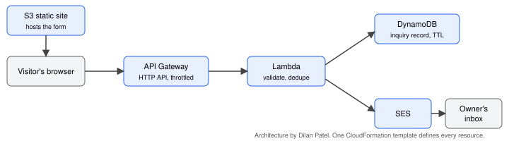

# Inquiry Service

A small serverless "contact us" service. A visitor fills out a form on a static website,
the inquiry is saved, and the owner gets an email with the details. Built by Dilan Patel
for CS 79C (Santa Monica College), AWS Architecture Portfolio Project.

## Architecture



| Service | Job |
|---|---|
| S3 | Hosts the static HTML form |
| API Gateway (HTTP API) | Public HTTPS endpoint, CORS, request throttling |
| Lambda (Python 3.12) | Validates input, saves the inquiry, sends the notification |
| DynamoDB | Stores every inquiry (source of truth) |
| SES | Emails the owner a formatted notification |

All infrastructure is in `template.yaml` (CloudFormation).

## Deploy

Prerequisites: AWS CLI configured for `us-west-2`, `zip`, and a domain you control that is
verified in SES in `us-west-2` with Easy DKIM (3 CNAME records, status SUCCESS). Sending from
an authenticated domain is what keeps notifications out of the spam folder.

```bash
scripts/deploy.sh owner@yourdomain.com inquiries@yourdomain.com
```

The first address receives the notifications, the second is the From address. The script
checks the sender's domain is verified, deploys the stack, uploads the Lambda code from
`src/handler.py`, writes `web/config.js` with the API URL, and publishes the site.

It prints the site URL at the end. Open it, submit the form, and check your inbox.

## Test from the command line

```bash
scripts/smoke-test.sh
```

Sends one valid inquiry, repeats the same request id (it should report `duplicate` and
send no second email), then sends an invalid one (it should return a 400).

## Tear down

```bash
scripts/teardown.sh
```

## SES sandbox note

New SES accounts are in the sandbox: mail can only go to verified addresses or addresses on a
verified domain. This project sends to an address on its own verified domain, so it works in
the sandbox.

## Text-message notifications (extension, not built)

The owner is notified by email. Texting is the natural next step: Lambda would also publish
to SNS SMS. It is documented as an extension and not built because US SMS needs a registered
origination number (toll-free verification or 10DLC), which takes days to weeks, and it adds
a per-message cost, unlike SES email which is effectively free at this volume.

## Repo layout

```
template.yaml        CloudFormation: S3, API Gateway, Lambda, DynamoDB, IAM, logs
src/handler.py       Lambda function
web/index.html       Inquiry form
scripts/             deploy, smoke-test, teardown
docs/                report outline
```
